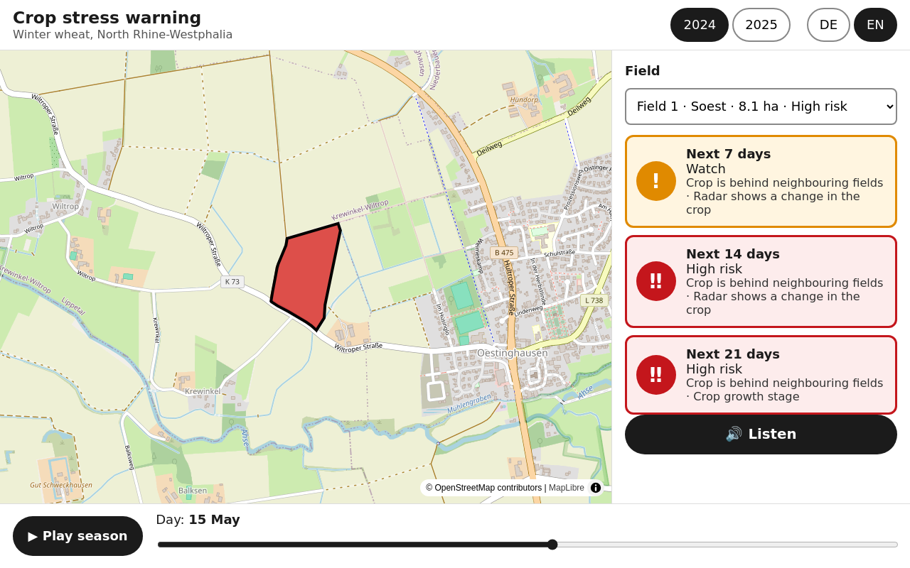
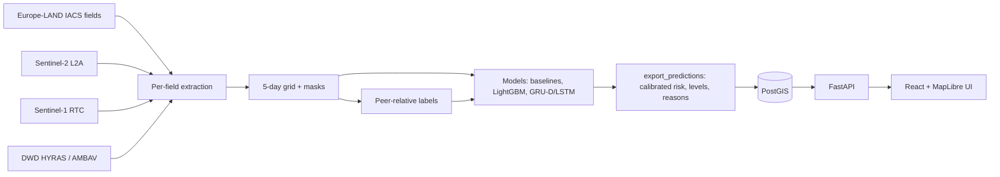

# crop-stress-ews

Early warning for **crop stress in winter wheat in North Rhine-Westphalia (NRW)**. For any
field and date, it predicts the risk that the field starts falling behind its neighbours within
**7, 14 and 21 days**. Inputs are Sentinel-2 optical data, Sentinel-1 radar and DWD weather. The
reasons are written in plain language, and a one-screen web app can read them aloud.



## Results (test season 2024, held out; preliminary: Soest, 40 fields)

| Horizon | Served model (logistic, calibrated) AUROC [95% CI] | Persistence baseline | Red alarm: sensitivity / false alarms per 100 fields |
|---|---|---|---|
| 7 d | 0.80 [0.64–0.94] | 0.66 | 0.17 / 25 |
| 14 d | 0.78 [0.62–0.91] | 0.70 | 0.31 / 62 |
| 21 d | 0.74 [0.53–0.90] | 0.69 | 0.47 / 132 |

- **Early warning:** red alarms came before 6 of 9 stress onsets, a median of **17.5 days**
  ahead ([error analysis](docs/error_analysis.md)).
- **Inputs that matter:** removing Sentinel-1 radar causes the largest accuracy drop of any input
  group ([sequence models](docs/sequence_models.md)).
- **Model choice:** GRU-D/LSTM and LightGBM perform on par with the served model; the confidence
  intervals overlap. The demo serves the simplest model, whose reasons are its own coefficient
  contributions ([ADR 0012](docs/decisions/0012-api-and-demo-model.md)).
- **Next:** the six-district rerun (about 5× the test fields) is pending the Sentinel-1
  extraction. See the [model card](docs/model_card.md) for limitations.

## Why it is built this way

- **No leakage.** Splits are by season: train 2019–21 and 2023, validation 2022, test 2024 (a
  wet, poor season). Label baselines, scalers, calibration and alarm thresholds are all fitted
  without the test season.
- **An honest label.** The first label (below the multi-year norm) tracked dry springs, not yield
  loss. The revised label compares each field with same-date district peers
  ([ADR 0010](docs/decisions/0010-peer-reference-label.md), [label sanity](docs/label_sanity.md)).
- **Missing data stays visible.** Satellite values are never forward-filled. Every input has an
  observed mask and a days-since value.
- **Built for non-experts.** Colour is never the only signal (each light also has a symbol and a
  word), the result can be read aloud in EN/DE, there is a keyboard path, and the season can be
  replayed ([ADR 0013](docs/decisions/0013-one-screen-ui.md)).

## Architecture



## Scope at a glance

| | |
|---|---|
| Region | NRW, core districts Soest, Warendorf, Höxter, Coesfeld, Düren, Rhein-Erft-Kreis |
| Crop | Winter wheat (`winter_common_soft_wheat`, NRW code 115) |
| Seasons | 2019–2025; prediction window 1 April – 31 July |
| Splits | train 2019–2021 + 2023, validate 2022, **test 2024 (wet year)**, extra check 2025 |
| Fields | ~54k–71k winter-wheat parcels per year (Europe-LAND IACS, CC BY 4.0) |

## Run the demo locally

```bash
python scripts/export_predictions.py          # needs processed data (pipeline below)
docker compose up -d --build && docker compose exec api python scripts/load_db.py
cd web && npm install && npm run dev          # http://localhost:5173
```

API: [docs/api.md](docs/api.md) · UI: [docs/ui.md](docs/ui.md)

## Data pipeline

```bash
pip install -e ".[dev,extract,model,seq,api]"   # seq needs PyTorch (CPU wheel is fine)
pre-commit install

# 1. Field parcels (≈350 MB per year, extracted from the Zenodo zip by range requests)
python scripts/download_nrw_fields.py --years 2022 2024

# 2. District boundaries: BKG VG2500 (dl-de/by-2-0)
curl -L -o data/raw/vg2500.zip https://daten.gdz.bkg.bund.de/produkte/vg/vg2500/aktuell/vg2500_12-31.utm32s.shape.zip
unzip data/raw/vg2500.zip -d data/raw/vg2500

# 3. Per-field extraction for one district-season (same --n everywhere so the tables join)
K=data/raw/vg2500/vg2500/VG2500_KRS.shp
for x in s2 s1 weather; do python scripts/extract_$x.py --year 2024 --district Soest --n 30 --districts $K; done

# 4. 5-day grid, peer-relative labels, label sanity against IT.NRW yields
python scripts/build_grid.py --year 2024 --district Soest
python scripts/build_labels.py --district Soest
python scripts/download_yields.py && python scripts/label_sanity.py --districts $K

# 5. Models (needs all seasons 2019–2025) and error analysis
python scripts/train_baselines.py && python scripts/train_sequence.py
python scripts/export_predictions.py && python scripts/error_analysis.py
```

## Layout

```
src/cropews/        data loaders, extraction, grid, labels, features, models, evaluation, API
scripts/            command-line entry points (extract_*, build_grid, build_labels, train_*, export, load_db)
web/                React + TypeScript + Vite UI (Vitest, Playwright)
migrations/         Alembic migrations for PostGIS
tests/              offline unit tests + API tests against PostGIS
docs/               project memory, decisions (ADRs), results, model card, milestones
```

## Data sources and licences

Europe-LAND Harmonized IACS inventory (CC BY 4.0, cite original sources), Copernicus Sentinel-1/2
via Microsoft Planetary Computer, BKG administrative boundaries (dl-de/by-2-0), DWD Climate Data
Center (CC BY 4.0), IT.NRW harvest statistics. Details: `docs/decisions/0002-data-sources.md`.

## Licence

Code: [MIT](LICENSE). The datasets are not included in this repository and keep their own licences
(see above).
